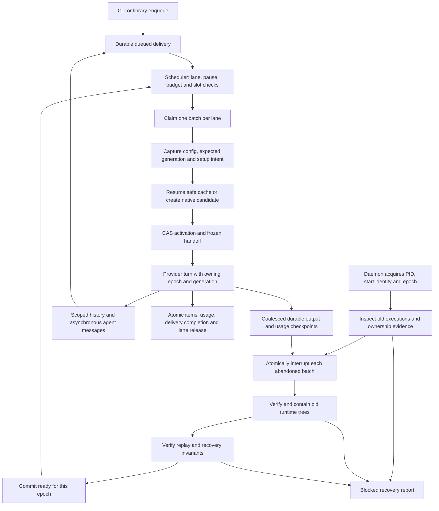

# Engine lifecycle

Kru keeps accepted messages, delivery attempts and logical threads in SQLite.
Provider CLIs execute turns; their session files are disposable conversation caches.
The engine uses one Store dispatch boundary for domain events and projections.

Claims and provider startup are gated until boot is ready. Store writes check
the daemon epoch under SQLite's writer lock; provider/tool boundaries also check
the active execution and session generation. Ownership loss stops scheduling.

Migration v8 adds recovery evidence, quarantine and usage-gap projections.
Migration v9 adds canonical history, numbered session lineage, frozen packets
and confirmed-use facts. Replay compares twenty-two domain tables. Lock/boot records, runtime ownership,
cleanup journals and scratch checkpoints remain operational state: replay never
spawns a process, reconstructs a lock or assumes an external effect was undone.

Process operations run outside SQLite transactions. Linux and macOS cleanup
uses a recorded start identity from a living process in the original group.
A numeric PID/group alone never supplies authority. Unknown descendants or
malformed ownership keep the boot barrier closed. Detached processes and effects
outside the verified tree are outside the recovery guarantee.

See [M7 recovery](m7.md), [M6 threads](m6.md), [M5 messaging](m5.md),
[M4 dispatch](m4.md), and [security boundaries](../SECURITY.md).
